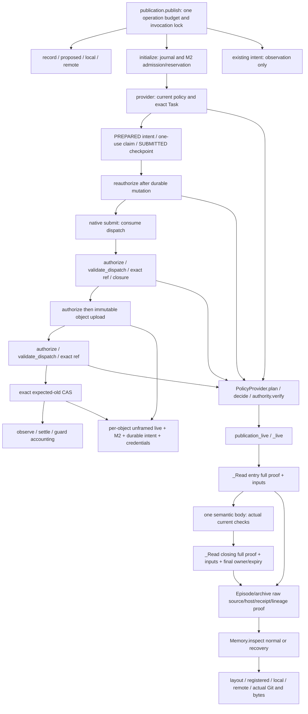

# Publication call graph and observation-reuse audit

Audited source: `2b0ecd6f4b26321a4938f6a0393dae2caa124ed8`, tree
`44f8a97f2cfbeffbada49cf781f75dc3505a2ef7`. All line citations below refer to
that immutable source, not shifted lines in the subsequent minimal repair.
The [source manifest](PUBLICATION_CALL_GRAPH_SOURCES.json) binds the union of
inspected modules. The independent readable subgraphs are reproduced below;
their underlying lexical inventory remains private with integrity references.
The reproduced Read section corrects citation offsets against immutable `2b0ecd6`;
the manifest retains the hashes of the unchanged original private audit inputs.
This is static engineering analysis, not a runtime trace or release authority.

## Decisions and interpretation

- **A — mandatory independent observation:** retain actual entry/closing,
  post-mutation authorization, exact source/admin/credential/owner, stop and
  pre-CAS checks. Other clones, remote state, protected bytes and time may change
  even while the invocation lock is held.
- **B — safe same-observation reuse:** implement only the provider's adjacent
  generation/epoch/iteration projection and the product proposal's adjacent
  generation/checkpoint projection. Use one local actual snapshot at the old
  first-read position; it expires at that evaluation. No result escapes as authority.
- **C — pure computation:** immutable explicit-value serialization, hashing,
  closed payload parsing and existing visited sets/witness derivations. Actual
  presence, byte rehashing, comparison and current approval remain A. No new C
  cache is implemented.
- **D — unproven optimization:** retain execution_preview's separated reads,
  cross-callback/full-proof/engine/admin reuse and uncertain later-window paths.
  Similar names or an unchanged source SHA do not prove identical observations.

Mixed A/C rows identify a pure calculation INSIDE a mandatory observation, not
permission to cache the observation. Counts are per reached caller invocation;
failures short-circuit. Branches, pagination, documents, objects, workers and
callbacks can multiply costs. UNKNOWN means not statically fixed or resolved;
no exact path count is inferred from the aggregate telemetry.

The historical capture contains 8,318 Git calls, 521 Memory inspections, 14 live
proofs, 87 administration snapshots and 227 engine digests. Their measured
intervals overlap and must not be added. The observed 120-second root expired
in reauthorization after 122.872935 seconds and 47/128 requests, before native
submission. Those counts do not identify which nested branch each call took.
The fresh default is now operator-approved **150** (range remains40..300);
valid configured120, retained120 consent/M2 permits, old45 grants, original
expiry and cancellation/stop limits remain unchanged. Increasing a default
proves neither complete publication fit nor runtime qualification. A full
integration rerun is NOTRUN pending separate operator release.

## Publish entry, initialization and canonical-write expansion

Locations are `adp/<module>.py:<line>`. `frame` below aliases
`personal_read_frame`; `episode` aliases `personal_episode`; `history` aliases
`personal_history`. Graphs are compositional: any root-to-sink path follows the
edges here and in the policy/native and Read/Memory expansions below. Standard
library/schema leaf computations are not additional authority ports. Arbitrary
adapters, overrides or callback dispatch not resolved by these installed types
remain UNKNOWN; this is not a universal proof for third-party implementations.

| Caller -> callee, baseline source | Condition / multiplicity per caller | Phase and changing state | Reuse/security consequence |
| --- | --- | --- | --- |
| publication:531-535 publish -> service.bounded / invocation_lock / record:101 | each authorized call; one root context, one selected record | entry: inherited profile/permit/expiry can only tighten; lock does not freeze remote/other clones | A; no renewal or cached authority |
| publication:102-113 record -> protected private read -> journal.inspect:83 OR Memory.inspect | absent record checks no orphan PUSH; retained record checks generation (unless caller explicitly supplies observed) | entry/current ownership and durable intent | A; expected absence is evidence too |
| publication:539 proposed:235 -> local:135, remote:214, Memory.inspect:252 | only no-existing-intent branch; one full in-lock reconstruction | entry original/check/review/source/governance/credential and exact operator token | A; former redundant pre-lock reconstruction already removed |
| publication:139 local -> c.fresh:239; workers.fence:229; review_binding twice; original_approval:320; verify_local_review:773 | one complete local preflight; track/discovery and worker branches vary UNKNOWN | entry then closing review seal around real verification | A; no reuse of first review seal as closing observation |
| runner:239 fresh -> live:67; M4 original/track inspection and match; own scope/check-policy context | once per local; original inventory/pages and track branch UNKNOWN | source/issue/native dependencies/approval can change | A; expands original/worker/authority paths below |
| publication:548-551 -> local, remote, live | existing approved intent only | recovery admission, independent current read before observation-only settle | A; original token/profile retained; no dispatch remint |
| publication:552 initialize:433 -> live, Memory.inspect:436, journal.change:445 | every selected call; idempotent identical task admission | before M2 registration and canonical publication task mutation | A; immutable identity plus actual current state |
| publication:447-448 -> guard.admission_subject:168, proof:364, guard.register:179 | exact admitted requirement; register may return identical existing record | admission signature verification and possibly canonical mutation | A; same requirement cannot change thresholds/history |
| publication:451-467 -> guard._snapshot:122, private reservation save, guard.begin:227 OR exact active permit reuse | no reservation creates exact Action; no permit begins only if active absent; else exact stored context/action/sequence | mutation/finite attempt fence, actual deadline and counters | A; bind literal consent_limits, never replenish old120/45 caps |
| guard:173 admission_subject / :122 _snapshot -> Memory.inspect | one each reached call | independent current canonical task/health | A; task/owner/generation may change |
| guard:179-207 register -> _verify -> authority.verify; locked Memory._start; _checkpoint if new admitted state | branch may return existing matching requirement | verify exact admission; changes journal baseline | A; no cached verified admission across a write |
| guard:227-267 begin -> _change:134 -> Memory._start / transition / _checkpoint if changed / _decision | exact active state/limits; conditional checkpoint | lock-bound reservation/counter update and current accounting qualification | A; callbacks/clock may refuse; expanded Read graph applies |
| publication:554 -> journal.inspect -> Memory.inspect | each selected action lookup | current action, owner and generation after initialization | A; earlier snapshot preceded canonical writes |
| publication:565 /567 -> journal.change(PREPARED / SUBMITTED) | two on fresh dispatch path; recovery branch does not repeat | distinct canonical mutations around exclusive claim | A; reauthorization must follow these writes |
| execution_memory:118-130 change -> locked Memory._start; callback; execution_schema; _checkpoint iff actual execution diff | zero/one checkpoint per call | actual owner/remote baseline; callback cannot mutate other guard/task/owner fields | A; no cross-checkpoint snapshot reuse |
| Memory:376-387 _start -> author, pending absence, _local(dirty=False), _remote_head, _owner | every mutation start | current canonical Git/layout/files/remote and actual owner token; expanded reader graph below | A; dirty=False also verifies working JSON/task files/ignore bytes |
| Memory:411-450 _checkpoint -> optional fence; _read_ref(previous); lineage invariants; schema; durable pending; _finish; inspect | one per actual state change | exact old/new relation/counters, optional fence at multiple stages, protected atomic writes | A; no broad M1 migration or terminal-history bypass |
| Memory:452-488 _finish -> native HEAD; _write_files + add + commit OR exact already-committed state proof; _remote_head; _push if needed; pending unlink/sync | current==base vs exact interrupted-commit path; optional fences multiply; UNKNOWN totals | durable checkpoint/restart CAS, local/remote refs can move | A; each commit/push/ref confirmation remains independent |
| Memory:356-361 _push -> _remote_head; _remote_git(push); _remote_head + local HEAD | only remote differs from exact local checkpoint | before/after publication comparison | A; no blind retry/implicit merge |
| Memory:39-61 _write_git/_remote_git -> pinned-remote checks + git helper | each canonical writer command; pinned/local vs normal transport branches | root/remote identity and accepted Git safety | A; command totals vary with journal state |
| publication:558 /573 /580 -> port.observe OR port.submit | existing action observes; fresh dispatch submits once then observation-only uncertainty handling | external-effect boundary; downstream policy/closure/upload/CAS graph below | A; callbacks cannot be skipped or reused across upload |
| publication:581 settle:504 -> live, remote, journal.change, guard._snapshot/observe OR exact last observation; save | exact observed result only; branch depends on interrupted state | current result/M2 accounting, not independent progress or product acceptance | A; UNKNOWN/changed result cannot become PASS or a new write grant |

## Mandatory checks retained

Both complete raw entry/closing captures and input seals; all current private byte,
selector/absence, owner/generation/epoch/iteration and time/revocation checks;
independent original/code/staged/committed evidence; credentials and exact native
repository/ref/permissions/protection; actual source/index/admin/governance;
M2 finite permit and M3 post-mutation authorization; one-use durable intent and
stop marker/confirmed stop; all three native `_authorize` calls, both
`validate_dispatch` callbacks, per-object write callbacks, post-upload source/ref
check and exact expected-old CAS; observation-only uncertain recovery.

## Delta and qualification boundaries

Only B1/B2 below are new reuse implementations. No Memory/Guard/schema/closure/
transport/stop implementation changes accompany them. Product.execution_preview
retains both observations around mutable administration/journal/worker inputs.

Focused regressions compare full returned values/Task fields, actual invocation
counts and callback order, changed generation/epoch/iteration, missing canonical
state, new-call observation, expiry and retained120 M2/consent caps. The existing
bounded benchmark pattern adds20 alternating pairs of actual Memory inspection
components (two observations versus one) on identical owned disposable state,
with before/after filesystem/ref preservation. This is component timing, not
whole-provider/publication throughput or runtime qualification. No threshold
assertion or extrapolation from the original 521 aggregate inspections is used.
Complete integration/CI remains NOTRUN pending separate operator release.

## Independent policy and native dispatch expansion

Reference commit: `2b0ecd6f4b26321a4938f6a0393dae2caa124ed8`  
Tree: `44f8a97f2cfbeffbada49cf781f75dc3505a2ef7`

**Recommendation: implement only the two class-B field-sharing candidates below.**
All independent policy, raw-source/host, closing, mutation and recovery fences
remain A. Existing pure/immutable work is identified as C; no additional C cache
or broad proof reuse is demonstrated or proposed. execution_preview is D for
consolidation. No whole-integration rerun or timing/qualification claim follows.

The new explicit operator default150 authorization is accepted as new engineering
scope, with minimum40/maximum300 unchanged. This graph is of the actual2b source,
whose default is still120. It is not a claim about execution at150. The old120
and45-second errors remain unchanged. Production edits, tests/probes/runtime,
pilot/Worker/public writes were not performed by this reviewer. Only private
mode-0600 static review artifacts were written. Exact source HEAD/tree and initial
clean status were checked; the adjacent source manifest binds cited code.

## Legend and counting rules

- **A:** mandatory independent actual observation, authority, closing, effect or
  recovery fence. It can fail/change; do not reuse its success across its boundary.
- **B:** proven same-observation reuse inside one local evaluation, with no
  intervening callback, effect or independent observation removed.
- **C:** identical pure computation over explicit immutable inputs; no current
  authority/permission result. Any reuse requires the entire exact input identity.
- **D:** reuse unproven, outside this bounded proposal, or unsafe without new proof.

Counts below come from static calls/branches, not8318 aggregate Git entries or
521 aggregate inspections. Negative/short-circuit/data-dependent paths differ;
actual per-path counts not statically fixed are **UNKNOWN**. A graph edge marked
once means once per invocation of that caller on the stated branch, not once per
overall publication. Shared helper expansions below cover their descendants.

## Proven B candidates and rejected analogue

| ID / caller | Actual reads and condition | Role / multiplicity | State and safe lifetime | Verdict / risk |
| --- | --- | --- | --- | --- |
| B1 personal_publication.py:487-490 provider | inspect()[state], then inspect()[tasks][task].iteration; only pure Task argument/key evaluation between; source_authors executes afterward | internal Task construction;2->1 per provider | One actual snapshot supplies generation/epoch/iteration within this construction; keep source_authors after it; discard observation afterward | **B approved.** More coherent fields; no later safety/owner read is reused |
| B2 personal_product.py:272-273 proposed | generation inspect then checkpoint inspect, adjacent after merge_envelope | internal consent-view construction;2->1 per reached proposal | Finish earlier view fields/callbacks THROUGH merge_envelope, then inspect at old first-read position and append generation/checkpoint/time fields from it | **B approved.** Do not hoist the read before earlier admin/record/validation work; later credential/expiry checks remain |
| D1 personal_product.py:545-548 execution_preview | generation inspect; then administration Git, product journal/pull and worker inventory; then checkpoint inspect | separate positions around mutable work;2 reads | Intervening Git/private/worker observations may differ; no same-observation proof established | **D, retain both positions.** Do not infer safety from similar field names |

B1/B2 neither preserves a previous ALLOW nor removes a post-write check. Their
tests should require coherent generation/epoch/iteration or generation/head from
one actual observation, preserve earlier callback order, and show subsequent
independent drift/expiry still refuses. Only focused checks and fresh exact-HEAD
review are within the current task; the990-second complete campaign is forbidden.

## Policy plan/decide and publication authority fan-out

| Edge / exact caller -> callee | Condition / static multiplicity | Role and changeable inputs | Class / reuse decision |
| --- | --- | --- | --- |
| P1 policy.py:216,235 plan -> inspect_repository:103 | every plan after structural request validation;1 | entry current repository/policy inspection; refs/index/config/rules can change | **A** fresh at each plan |
| P2 policy.py:104 inspect_repository -> adapter.inspect |1 per inspection | current Git/remote source; expands G below | **A** never cached by source SHA alone |
| P3 policy.py:112-133 sources loop -> source_subject + _verified:51 -> authority.verify | per source reaching matching/freshness branch;0..S, actual UNKNOWN on rejects | source identity, exact document/scope and current authority; source_subject is pure only when explicit snapshot supplied | verifier **A**, explicit-input subject computation **C** |
| P4 policy.py:379-394 plan -> protection_subject -> _verified(protection) | relevant target protection0/1; only when known/current/fresh | independent actual protection binding, target revision/native policy may change | verification **A**, explicit-snapshot subject hashing **C** |
| P5 policy.py:416 -> _safety:197 -> ReservedSafety.observe | once unless policy already denied | current M1 owner/M2 permit/canonical approval/window; expands S below | **A**, not a previous Plan.safety reuse |
| P6 policy.py:493-500 decide -> plan |1 before comparison | re-observes current repository/index/refs/policy/safety; whole Plan equality rejects stale/edited plan | **A** mandatory even if caller just built plan when a proof/write intervenes |
| P7 policy.py:535-580 decide -> _verified(check/review/project policy) | only gated ALLOW; up to32 checks/16 reviews plus policy; actual UNKNOWN | fresh exact-source independent evidence, author exclusion, expiry; standard publication PUSH is not gated by its fixed Rules | **A** where reached; cannot reuse generic authorization |
| P8 policy.py:582-585 decide -> _verified(operation) -> publication.verify | authorization supplied and effect not DENY;0/1 | exact entire current Plan/qualifications, operator approval/provenance | **A**; authorization_subject over explicit Plan is **C** |
| U1 personal_publication.py:364-370 proof -> live -> validate_proof |1 live per proof creation | entry current consent/source/reviews before proof creation; validate_proof also reads current publication record | **A**; do not collapse live/record fences under B1/B2 authority |
| U2 personal_publication.py:371-378 proof -> create_private/read_private or atomic no-replace |1 proof; existing hash compares or new evidence file persisted | **durable private mutation**; existing proof conflict/capacity and exact body matter | **A** boundary; do not carry earlier policy success across it |
| U3 personal_publication.py:381-390 verify -> live, protected proof read/digest, validate_proof |1 live per reached authority callback | separate actual callback; current consent/evidence may change; proof purpose/subject/principal must match | **A**, no cross-callback live reuse |
| U4 personal_publication.py:395-428 validate_proof -> record; typed source/protection/operation subject checks |1 current record per validation; branch by kind | record checks current generation via Memory.inspect when no observed snapshot supplied; typed payloads/digests alone are pure | record **A**; pure explicit value parsing/hashing **C**; no proposed observation removal |
| U5 personal_publication.py:471-493 provider -> live, adapter.inspect, S source proofs, protection proof, two Memory reads, plan, operation proof, decide | one on new publication branch; source count data-dependent | builds claims then validates exact fresh authority; private proof files can be created | all authority/inspection calls **A**; only B1 field pair eligible |
| U6 personal_publication.py:497-501 reauthorize -> plan, proof(operation), decide | one after canonical SUBMITTED checkpoint | **post-durable-mutation** current policy/safety/authorization; only safety field permitted to differ in preliminary comparison | **A** all three; no reuse of provider's earlier ALLOW |

For a complete non-gated publication PUSH, let S be the actual eligible source
claims and P the relevant protection (normally1). A complete plan invokes S+P
publication.verify calls; a complete decide invokes another plan plus one operation
verification. From code, provider invokes3S+3P+3 publication.live calls; reauthorize
invokes2S+2P+2. For S=P=1 these are9 and6, respectively. These formulas assume all
specified branches complete and no extra gated qualification callbacks. They are
not claims about the interrupted120-second execution or aggregate Git counts.

## Expansion G: actual Git/repository inspection

| Caller -> callee / location | Condition / count | Role / mutable inputs | Class / recovery risk |
| --- | --- | --- | --- |
| policy_adapters.py:82-95 inspect -> Config.discover:84 + native HEAD/ref/endpoint/index/diff/untracked/local refs | every adapter inspection; fixed listed queries plus Config-dependent queries | entry local selected root, effective remote and worktree; config/indirection/index/refs can change | **A** actual values; closed snapshot construction/hash is **C** |
| policy_adapters.py:98 -> network_git.py:321 _remote_refs -> _endpoint:326 -> Config.discover and service.refs:229 | every remote inventory; paging UNKNOWN | independent endpoint validation before authenticated HTTP refs; no Git remote-helper fallback | **A**; earlier Config discovery is not safe to substitute after intervening work |
| policy_adapters.py:120-132 -> ls-tree + per selected document cat-file size/body, optional profile parsing | selected documents D;1 tree +2D object queries | actual committed governance/profile/contract bytes; availability/corruption and selection can change | actual reads **A**; immutable byte parsing/digest **C** only with exact complete fresh bytes |
| policy_adapters.py:110-115 -> merge-base | only differing known remote old/head | current available ancestry, no fetch | **A**; immutable mathematical relation alone is not current availability proof |
| policy_adapters.py:142-145 -> closing HEAD/ref/index rereads | every successful inspect;3 queries | **closing** mixed/racing repository-read refusal | **A**, never entry snapshot reuse |
| config.py:96-151 discover | used by adapter/endpoint/historical exact-ref/local_checkout | config JSON, remote set, native effective fetch+push endpoints, selected branch/storage/worktree binding; count data-dependent | **A**, no raw-config or remote-v replacement for native URL semantics |
| execution_ports.py:97-111 _git/_value | every bound native source/object command | actual root/gitdir/common device/inode +2 real Git path checks, then explicit pinned command | **A** pins EACH command; combining commands/new pin grammar is not proposed B/C here |

## Expansion L: publication live reconstruction and raw provenance

| Caller -> callee / location | Condition / multiplicity | Role / changeable inputs | Class / reuse decision |
| --- | --- | --- | --- |
| personal_publication.py:290-296 live -> read_frame.publication_live:393 | episode AND review=True; each callback | one synchronous local read; expands F below | **A** independent live call; existing bounded frame internals only |
| personal_publication.py:292-296 live -> _live_current:298 | review=False or non-episode | per-object path is deliberately **unframed**; source/canonical/owner may change since prior object | **A**, no frame inherited across effects |
| personal_publication.py:302-317 _live_current -> coordinator.live, record(observed), HEAD/tree/ref/status, administration, workers.records, review_binding, credential, optional verify_local_review | once per body | actual current source/admin/worker/private credential and operation expiry | all actual checks **A**; exact supplied observed generation already shares one snapshot as existing B |
| personal_runner.py:67-90 live -> track.require_attachment, Episode._active_view, Memory.inspect, record, check_administration, episode_fence | episode branch once plus conditional track | current attachment, canonical owner/state, generation/source/admin/window/revocation | **A**; common Episode leaf E below; final Memory read not reusable from entry proof |
| personal_runner.py:121-128 check_administration -> personal_git.administration, accounting historical path-reader variant | checkout always; feature when retained binding exists | physical root/.git/gitdir/common identity/ownership/mode/content; native context paths | **A**; process batching already exists; no identity/status memo |
| personal_publication.py:154-187 review_binding -> c.worker/records, guard._decision twice, source_origin(historical=True) | original/code pair;2 decisions on valid path | actual canonical accepted assignments/guard context; original Developer/adopted author provenance | **A**; baseline tuple/digest construction **C**, not a Developer PASS |
| personal_runner.py:773-783 verify_local_review -> administration, worker, HEAD/ref/status, workers.actual, guard.require_approval | when review=True | current exact SHA, stopped code Reviewer, canonical independent approval | **A**; do not substitute field digest for raw authority |
| personal_workers.py:82-128 actual -> runtime.observe, Memory.inspect, records; Episode.active; guard snapshot/allowed if accounted | per actual worker verification; accounted active/inactive branches differ | actual host/request/stop/result/context/accepted delivery, canonical task and charged role | **A**; number of nested full/fast active calls depends on frame/branch |
| guard.py:496-507 require_approval -> _snapshot, _decision, _verify -> PersonalAuthority.verify | per required code approval | exact baseline/author exclusion and real progress receipt | **A**, not just item.approval presence |
| personal_authority.py:74-90,121-142 verify/_validate(progress) -> c.live, protected receipt, generation inspect, worker.actual, guard._snapshot | progress path; fixed caller edges, nested count UNKNOWN | current personal approval plus canonical progress/result provenance | **A**; typed payload/subject computation alone **C** |
| personal_runner.py:141-174 source_origin/source_authors -> adoption.original_material/adopted OR retained Developer provenance | retained vs actual Developer branch | original retained archive/raw scope worker/adoption receipt/files or accepted unapproved Developer; includes actual Memory/runtime | **A**; do not generalize one origin branch's cost/authority to the other |
| personal_adoption.py:23-60 original_material/adopted -> archived, retained runtime, Memory.inspect, exact receipt/intent/manifest files | adopted source branch | stopped original contexts, accepted new scope, exact two-file origin/marker/CAS provenance | **A**; source-label/hash projection is not a full fresh approval |
| codex_runtime.py:123-160 observe -> _read/_stop_receipt and actual host/process/stop handling | per raw worker; optional absent/runtime-status branches | actual protected bytes/absence, host/PID/start/stop; no Worker dispatch in these read paths | **A** current observation; cached runtime receipt verdict prohibited |

### F: existing private frame, not permission for new frame expansion

read_frame.py:361-389 performs entry _Read, inputs, ONE semantic body, independent
closing _Read, inputs, exact proof/input/result comparison, then fresh Memory and
actual episode/operation expiry. _Read:279-294 takes the byte manifest BEFORE full
Episode._active_view under _BOUND_BYTES with _CURRENT absent. Thus every FULL
executes actual raw/history/source/host/admin proof. inputs:305-312 independently
reads child source/admin/governance/credential/worker/private inputs plus
_legacy_inputs:243-262 (engine, old source seals/physical admin/current snapshot).
run:328-339 installs only factual shortcuts around the one body and resets finally.
current:320-325 ALWAYS performs fresh Memory.inspect/time/revocation. active:342-348
and archive:351-358 return defensive copies only for exact matching context.

Each full live call therefore has two independent FULL captures and two input
seals; nested factual queries have fresh current-memory checks with no fixed
aggregate count. These are **A** entry/internal/closing distinctions. Reusing a
FULL snapshot as a later input seal reopens captured-admin/source/byte ABA gaps.
No new B/C optimization may remove these boundaries, normalize input differences,
cross a write or extend _CURRENT/_BOUND_BYTES to native operations.

### E: Episode/archive/native history leaves

| Caller -> callee / location | Condition / count | Mutable/immutable inputs and class |
| --- | --- | --- |
| personal_episode.py:88-107 _active_view -> frame active OR _archived_view | shortcut only exact existing frame; otherwise FULL | **A** actual current context or independent FULL; descriptor/root intent/marker/directory checks |
| personal_history.py:40-149 _archived_view -> engine_digest:68; history_git.verify:74; grants loop:82-90; recovery Memory.inspect:94; ancestry:95; raw workers:114-136; source seals/admin:139-149 | two original stage grants, recovery records bounded; workers/refs/later links conditional | **A** actual host/raw/source/current canonical/owner/gen/guards; engine/file hashing not cached by HEAD |
| personal_history.py:155-212 validate_administration -> administration_snapshot:157; later_windows/scope_proof/exact_ref/accepted_merge when qualified later links exist | data-dependent later history; actual count UNKNOWN | **A** current exact allowed refs, original config/index/ref and actual native later acceptance; do not blanket ignore refs |
| personal_episode.py:110-137 _active_view -> expected_relation; activation/intent; history_git.verify:127; current ancestry:130; optional time/revocation | each FULL; same-call archived actual view and authenticated rows already shared | **A** canonical relation/H3 activation/current ancestry; relation derivation with explicit facts is **C** |
| personal_history_git.py:62-91 verify -> storage_context + object_inventory actual bytes; miss also Memory._read_ref/parents/tree enumeration | witness hit vs miss; objects<=32; miss/hit frequency UNKNOWN | existing **C** immutable witness ONLY; current config/path/rewrite/storage and ALL object bytes rehashed every hit remain **A** |
| personal_history_track.py:85-197 later_windows/scope_proof/exact_ref/accepted_merge -> deterministic admitted originals, raw runtime/M1, HistoryReadPort/observe, v1 accepted | later links/ref/accepted merge branches; actual UNKNOWN | **A** frozen registration/next-intent/physical current refs/actual native acceptance; readonly transport absence refuses, no credentials discovered |
| personal_history_product_git.py:43-54,97-177 HistoryReadPort/observe -> current pins/config/replace checks, actual HEAD/closure bytes, symbolic ref/action/ancestry caller | COMMIT witness vs native fallback; unsupported envelopes native | existing **C** immutable structural facts; all current/pinned bytes/refs/source/authority remain **A** |
| personal_recovery.py:66-88 engine_digest/grant;131-138 administration_snapshot | engine enumerates actual module bytes; grant binds exact current digest; snapshot7 native queries (newline fallback9) | engine/admin/grant current reads **A**; exact explicit-body digest derivations **C**; no new cache proposed |
| execution_containment.py:15-40 source_seal/admin_seal | source bounded FS inventory; admin4 Git queries | **A** current worktree bytes/modes, effective config/index/refs/symref; hashes alone not current-presence proof |

## Expansion S: safety and canonical memory leaves

ReservedSafety.observe (execution_policy.py:31-58) performs guard._snapshot
(Memory.inspect), then _qualified_accounting -> publication.qualify_accounting
-> c.authority.qualify_accounting (personal_authority.py:25-39): Episode._active_view,
another actual Memory.inspect, exact state/task equality and final episode fence.
It verifies the exact active permit, bounds/time and optional stored progress
approval, tightens only the remaining runtime allowance, then performs a FINAL
Memory.inspect for health/owner/head. These are **A** independent safety/current
observations, not B1's data-construction pair. Guard._decision (guard.py:81-104)
also invokes accounting qualification when the child would otherwise ALLOW.

Memory.inspect (memory.py:280-316) reads actual pinned remote, registration, HEAD,
canonical tree/all blob bytes/decode/bundle, current layout/status, pending/slots,
owner token and inbox. Native leaves are verify_pinned_remote:63/_remote_head:73;
_registered:138 or accounting native query:161; _read_ref:86/_accounting_blobs:115;
_layout:194/_local:221; final status; _owns:363. Recovery adds the protected journal/
slot qualification and a SECOND actual registration. Default/writer paths retain
their original behavior. Existing batches return no remembered current state or
ALLOW. All actual observations **A**; JSON/schema derivation over supplied actual
bytes **C**. A different caller's Memory observation is never implicit B reuse.

## Native submit / objects / per-object / CAS mutation graph

| Edge / exact caller -> callee | Successful static multiplicity / condition | Boundary / changeable inputs | Class / authority-recovery risk |
| --- | --- | --- | --- |
| N0 publication.publish:565-568 -> journal.change PREPARED; prepare_dispatch; journal.change SUBMITTED; reauthorize | one new intent; existing branch observe-only | canonical durable checkpoints and fsynced exclusive claim; M1 head/intent changes | **A**; original plan success cannot span these writes |
| N1 network_git.py:374-394 prepare_dispatch -> _endpoint, _intent, _claim, exclusive fsynced file | one fresh in-memory ticket from actual PREPARED; no restart mint | durable one-use capability/owner/gen/action binding | **A**; no file/old ticket replay |
| N2 network_git.py:444-452 submit -> consume ticket, compare exact claim, _authorize | once at submit entry | consuming dispatch is nonrepeatable; current SUBMITTED/owner/gen/source/policy required | **A**; recovery observes only |
| N3 network_git.py:396-417 _authorize -> provider.decide; _endpoint; pinned HEAD/ref; optional ancestry; _intent -> journal.inspect | THREE calls on complete PUSH path:452,458,461 | entry, after closure before upload, AFTER upload before CAS; host/config/policy/current M1/remote can change in between | **A all three**; no old ALLOW reuse across durable/remote effects |
| N4 _intent:356-362 -> execution_memory.py:83-87 inspect -> Memory.inspect | once per _intent | exact unique durable action fields, SYNCED schema/current owner/gen/status | **A**; not cached from prepare_dispatch or another _authorize |
| N5 submit:453-455 -> validate_dispatch; inspect_ref(writable=True) | pre-upload once | current original source/governance/native prerequisites/remote policy/expected old | **A** independent fence |
| N6 submit:456-457 -> network_objects.closure:113-151 -> pinned _git/_value; service.known_commit | closure once before upload; local object/commit frontier data-dependent UNKNOWN | no mutations until entire representable closure validated; SHA1, depth/bytes/object bounds | actual native bytes/remote presence **A**; same-call visited-set/payload parsing **C** already present |
| N7 closure:118-133 -> object format; size and body per locally read object; object_oid |1 format +2*L local queries; L actual UNKNOWN; known commit short-circuits | current object availability/corruption; no-replace; per-command pins; immutable OID equality | reads/pins **A**; pure OID/content parsing **C**; no across-operation presence cache |
| N8 closure:127 -> service.known_commit:285-290 -> request(GET) | each visited commit before skip; count conditional | actual remote repository/object existence/identity, no fabricated known object | **A**; visited-set suppresses identical nodes only within this closure (**C**) |
| N9 submit:459 -> service.upload:292-297 -> request(POST object) | N local ObjectPayload entries;0..512 on representable closure | each actual remote immutable write; response oid must match | **A** per object; tuple payload/encoding is **C** explicit content, not upload success |
| N10 each mutation request -> PersonalGitHubTransport.request:95-130 authorize_write -> publication.write_authorized:320-331 | N object POSTs plus1 CAS on complete real personal path; fixture entries are not success proof | fresh unframed live(False), guard snapshot, journal.inspect, actual active permit/deadline/SUBMITTED; credential/context/deadline fresh before child | **A every callback**; cannot share across objects or CAS |
| N11 submit:461-464 -> post-upload _authorize, validate_dispatch, inspect_ref(writable=True) | one complete closing sequence after all uploads | drift during transfer must invalidate late CAS; original/raw/ref/owner/policy may change | **A**; strongest closing fences retained |
| N12 submit:466 -> service.cas:299-307 -> request(GraphQL mutation) | once only after all prior gates | exact expected-old/nonforce atomic ref CAS and mutation receipt; per-request write callback still runs | **A**; no retry/staging-ref/REST fallback |
| N13 submit:467-469 -> observe:424-442 -> _endpoint, pinned HEAD/ref, _intent, inspect_ref | after normal CAS or caught ADP/OSError; once along chosen path | authenticated exact target revision only; old/different after possible submission stays UNKNOWN | **A** recovery fence; no second dispatch/upload/CAS grant |
| N14 publication.settle:504-527 -> live, guard snapshot/observe, journal.change and personal save/accounting | only observed exact publication result | durable completion accounting, no independent meaningful progress fabricated | **A**; no retained successful observation substitutes for current reconciliation |

validate_dispatch (personal_publication.py:334-357) itself calls independent
live, workers.fence:229, original_approval, local_checkout (Config/native branch/
HEAD), old/child governance, optional track.publication_prerequisites, complete
current_original before/after/paged observations, enrollment rules and remote
identity/expected-old. Current original has K<=8 bases,2 one-item observations
and4 paged endpoints per base; exact page/HTTP/helper counts are UNKNOWN, bounded
by their existing inventory/profile rules. Both pre-upload and post-upload calls
are **A**. Do not substitute the preview's map or pre-upload map after effects.

service.request (network_git.py:164-213) -> _check_stop, shared Budget/M2/profile
deadline, durable _start_request:127-141, actual transport, confirmed stop:143-152,
deadline/count/response/decode checks. Every actual transport may change outcomes;
start/confirmed-stop are **A durability/recovery** fences even on GET, not C hash
work. Personal transport then verifies route/recipient, current per-mutation
callback, actor/credential, remaining deadline and supervised child. request
budget/unknown-stop success is never cached. Pure serialization/digests over
explicit payloads are **C**, with no new reuse proposal in this audit.

## Candidate disposition and scope limits

Approve B1/B2 only at their existing observation positions. Keep D1 unchanged.
No new decoder/hash cache or consolidation of live/proof/_authorize calls has a
demonstrated exact lifetime/invalidation proof here. In particular, proof files
and journal/remote writes are durable boundaries even when product source SHA
is unchanged. An invocation lock does not freeze other clones, native remote
policy, private proof bytes, process receipts, time or revocation.

The150 default change requires its own exact-revision check, literal retained
consent behavior and focused profile/authority regression checks. This graph
does not authorize modifying request/count caps, old grants, Worker quotas,
source/role provenance, crash/unknown-stop protocol or workflow evidence. It
grants no complete integration run; new CI/full-chain status must be reported
honestly as NOTRUN/pending until explicitly authorized and observed. No per-path
count or timing is inferred from8318 aggregate Git processes or the990s fixture.

## Independent Read, Memory and episode expansion

Source: `2b0ecd6f4b26321a4938f6a0393dae2caa124ed8`; tree `44f8a97f2cfbeffbada49cf781f75dc3505a2ef7`. Scope is the required publication frame, its normal/recovery Memory readers, episode/history authentication, and the incoming local verification paths described below. Initial extraction preceded implementation; all 33 selected file digests were subsequently verified against immutable `git show 2b:...`. Worktree edits by the author after that point do not change this baseline audit.

Decision: the mandatory freshness graph is explicit; no new blocking defect established. Keep entry/closing full proofs, actual private-byte binding, current canonical owner/state/consent checks and unframed mutation boundaries. The two proposed provider/product Task projections are B/C local snapshot projections, not authority reuse. This report proposes no additional implementation. A fresh default of 150 may be implemented under the new operator instruction, retaining 40/300 bounds; it must not expand an existing 120 grant or legacy 45 grant. No complete integration repeat or CI run was performed or authorized by this audit.

## Evidence and interpretation

The accompanying JSON contains **211 selected functions, 2,838 lexical call sites, 33 source files**, each with exact source lines, call expression, lexical branch/short-circuit conditions, enclosing loop expressions/literal factors, candidate resolved receiver and explicit UNKNOWN resolution. This inventory is not a measurement or whole-application execution trace. The manual graph below resolves the required paths and is authoritative for A–D role/reuse classifications. Standard-library and bounded schema/data operations are leaves; arbitrary callbacks and conditional historical native routes retain UNKNOWN totals. Nested call graphs are represented as directed edges rather than an unbounded enumeration of combinations.

A = mandatory current identity, policy, ownership, timing, raw-evidence or effect fence. B = local actual-observation redundancy eligible only for the described same-call projection/read. C = input-pure computation; reusing a value is safe only for identical already-authenticated inputs and without removing required comparisons. D = multiplicity, dynamic dispatch, equivalence or future cost not proved. A routine can contain pure C operations while its observation boundary remains A. All multiplicities below are per invocation reaching that row on a successful path; failures short-circuit. Source locations are exact `adp/<filename>.py:<line>` on 2b.

## Entry, body and closing graph

| Call site → target | Condition and static multiplicity | Role, state changes and reuse consequence | Class |
|---|---|---|---|
| personal_publication:290–296 `live` → personal_read_frame:393 `publication_live` → :361 `_live` | `review=True` and `c.episode`; one frame per live callback. review=False and ordinary legacy take `_live_current` directly | Read callback entry; no positive authority reuse between callbacks. review=False calls forbid_writes before the unframed per-object path | A |
| frame:364 and :369 `_live` → `_Read.__init__` :279 | Exactly two successful full captures, entry and AFTER the one semantic body | These are different temporal boundaries. Closing cannot move before the body or be replaced by the entry capture | A |
| frame:285 constructor → `_private_inputs` :107 | Once per constructor, therefore two | Actual closed rooted JSON inventory including absence; fstat/mode/owner/link/size/contents and selectors stay actual. No remembered bytes returned | A |
| frame:287–294 constructor binding → Episode._active_view :88 with `_capture` → constructor `current` :320 | Full proof once, then one normal current check per constructor | `_BOUND_BYTES` only during full proof; `_CURRENT` remains absent. Later body factual shortcuts are unavailable here. No canonical writes | A |
| frame:365/:374 → `_Read.inputs` :305 → `_inputs` :186 and `_legacy_inputs` :243 | Exactly two input seals, one after each complete capture | Rechecks child source, consent, runtime/private inventory and original source/admin; must equal each frozen inventory and each other | A |
| frame:366 → `_Read.run` :328 → owner `_live_current` | Exactly one original semantic pass; publication review=True or product genuine=False | Sets factual `_CURRENT` only inside this body, alongside byte binding; closes/reset context in finally. Body cannot admit/persist/dispatch | A |
| frame:333/:335 → `_Read.current` | Exactly two surrounding semantic body | Actual Memory.inspect, same_observation and episode_fence. Removing either changes temporal coverage | A |
| frame:370–380 closing capture/inputs/result comparison | Once after body | Compare identity, full active/archive/admin/consent and input seals; semantic return must equal actual sealed consent. No further semantic body | A/C |
| frame:384 → Memory.inspect; :385 → episode_fence; :386–389 own consent time | Exactly one final normal inspection and one final episode/own-expiry fence | Must follow closing inputs. Final current state/owner and exact operation expiry are separate from inherited episode expiry | A |
| frame:320–326 `current` → context, Memory.inspect, same_observation, episode_fence | Once per current query; nested count depends on caller | Actual canonical read every time. `_identity`/deepcopy/digests are C; comparisons/UTC/revocation are A. Returned actual state is not ALLOW | A/C |
| frame:342 `active` / :351 `archive` hooks → current | One per matching nested query; mismatched personal/memory/runtime/child returns None and executes full proof | Reuses only within one active factual frame, returns defensive factual copies plus newly observed state. No cross-callback cache | A/C |
| frame:315 context → `_identity` :265 | Every scoped context check; count follows actual read/selector/byte calls | PID/thread/object/path/intent/descriptor/runtime/authority/workers/track identities are mutable subjects and are recomputed. Do not cache a prior positive identity comparison | A/C |

## Input and byte-fence graph

| Call site → target | Condition/multiplicity | State/reuse security consequence | Class |
|---|---|---|---|
| frame:194 workers.records; :196–199 runtime/stop digests | One records scan; two digest reads per worker, <=16 workers | Reads only, including absence; no worker execution. Per-worker count depends on inventory | A |
| frame:200–206 progress reference digests | One loop over canonical requirements; read only for this task's non-null approvals | Exact private progress receipt SHA, actual path bounds and authority directory | A |
| frame:207–215 fixed/adoption digest reads | Five fixed paths; adoption present → exactly two manifest artifact reads | Explicit actual reads plus closed inventory below; not authority by hashes alone | A |
| frame:215–220 consent/run + four port._value queries | Publication uses owner.record(_observed=observed), avoiding another Memory inspection; product copies selected active. Four queries: HEAD, tree, symbolic ref, dirty status | Actual equality to exact approved consent/run/source branch/clean state. No current ref/status cache | A |
| frame:221 → history_product_git.administration, containment.admin_seal, enrollment.governance | Once each per `_inputs` | Physical ownership/inode/mode/path, current config/index/refs, committed rules stay actual | A |
| frame:229 → `_private_inputs`; :230–235 seal | One closed scan per inputs; four scans total per successful frame including two prefreezes | Returned closed map/root set must equal the relevant prefreeze and final seal. Sealing exact data is C, fresh observation/comparison is A | A/C |
| frame:112–160 `_private_inputs` | Four private_directory checks; rooted traversal <=4096 entries, depth<=16, <=1024 JSON; private bytes<=8MiB, separate ticket bounds; two explicit enrollment/marker reads; track adds <=8 original markers | Actual directory/JSON metadata and byte reads. A skipped symlink/foreign selector or optional-absence check would weaken the demonstrated readset protection | A |
| frame:164–183 `_private_digest` | One O_NOFOLLOW/nonblocking FD read per requested path; absent → None | Exact actual fstat ownership/link/size/mode checks. Read result is SHA only, not a permission/decision | A/C |
| config:24–54 load_json → frame:55 consumed | Once per actual JSON load; default M1 paths outside registered roots remain actual/unregistered | Actual raw bytes/metadata are checked BEFORE parse; consumed never returns cached data. Pure JSON/schema processing follows the actual read | A/C |
| storage:71–79 read_private → private_path/safe_path/load_json or consumed(absent) | One per private read; optional absent is explicitly bound | Prevent undeclared pointers and A/B restoration during body/full proof. Do not replace by remembered decoded object | A |
| frame:23 private_path / :31 present / :43 json_names / :55 consumed | When `_BOUND_BYTES` present, each first calls context; selectors/path/presence/bytes compared to frozen closed map | Fresh actual observations plus denial only; hooks do not recursively inspect Memory or return authority | A/C |
| ticket_preparation:126–136 `_read` → frame.ticket_bytes :84 | Only in an actual byte-bound frame; otherwise native reader unchanged | Actual FD, exact ticket 0600, archive 0700, bounded raw read. Reads original and baseline, not a new ticket writer | A |
| frame:251 `_legacy_inputs` → engine_digest | One per input pass, two per frame | Rehash actual engine source now; prior successful digest is not permission to skip later actual source check | A/C |
| frame:252–254 → source_seal(feature), source_seal(outside admitted paths), source_seal(original checkout) | Exactly three source seals per pass | Actual filesystem walk/metadata/content, bounded32MiB/4096; all compare to original master subset. No Git subprocess in source_seal | A |
| frame:257–262 → two physical administration reads + original run + administration_snapshot | Two physical reads and one mutable snapshot per inputs pass | Mutable snapshot must equal the exact snapshot captured by that full proof; this closes old-admin B-versus-seal-A restoration | A |

## Full Episode → archive provenance graph

| Call site → target | Condition/multiplicity | State/reuse security consequence | Class |
|---|---|---|---|
| episode:90–97 → frame.active hook | `_capture=None` only; matching frame can return factual view; `_Read` full captures force `_capture` and bypass this shortcut | Expiry checked where requested; full proof never uses nested factual shortcut | A |
| episode:99–104 → four private_directory and protected descriptor/enrollment/marker reads | One each set per unframed full proof | Exact original and child subjects; no state mutation | A |
| episode:106–107 → history._archived_view :40 | Once per full proof; supplied Memory prevents reconstruction | Actual original archival proof. With matching framed nested archive query, frame.archive executes current; otherwise full route below | A |
| history:53 / :55–62 subject loading | Child absent → load_state; supplied exact child → reread child descriptor/original enrollment/marker; memory absent → root.memory | Branch-specific extra Config/Git construction; not executed by ordinary supplied-memory _Read full capture | A/D totals |
| history:64–74 archive/master/engine/verify | One master, one archive receipt; engine_digest once; history_git.verify of three heads once | Exact raw receipts, engine and H0→H1→H2 immutable identity remain authenticated | A |
| history:76–79 recovery provenance loop | <=6 referenced receipts | Actual protected reads/digests, no reconciliation or recovery execution | A |
| history:80–81 submission_provenance; :82–93 consent/observed loops | Two stages each; two historical grant() validations, hence two further actual engine_digest calls | Original submitted marker and purpose-bound consent; old expiry is authenticated at actual submission time, never revived | A |
| history:94 → Memory.inspect(recovery=True); :95 ancestry | Exactly one current recovery inspection and one merge-base per full archive proof | Current parent task/generation/guard inventory must match immutable result; no canonical mutation or fetch | A |
| history:104 → CodexExecRuntime ctor; :112 run + :113 worker rows | Supplied runtime avoids ctor; normal full Read supplies no runtime, so one readonly ctor, no capabilities()/dispatch | Constructor reads machine/PID namespace/executable path identity only. Worker rows read/validate actual private ledger | A |
| history:121–135 two old Worker proofs | Exactly two retained original/developer roles: read raw+stop, runtime.observe, worker_result and numeric measurements | Runtime.observe reads retained status/stop; no dispatch/cancel/save. Other contexts must remain independent | A |
| history:140 → Coordinator.check_administration; :141–144 source seals | Physical checkout always and feature if original run has feature administration; two original source seals always, outer seal if original owner not None | Actual source/admin; owner-release historical case has different validation below | A |
| history:149 → validate_administration :155 | Once per full proof; captures exact actual administration_snapshot once | No reused validation result; capture is a defensive copy of the actual snapshot just validated | A/C |
| episode:111–112 expected_relation; :118–125 H3 activation/intent; :127–128 history_git.verify of two heads; :130 activation ancestry | One canonical relation derivation; one activation and one intent read; one second relation derivation through episode_intent; one two-head verification; one merge-base | install occurs only on deep-copied master state/tasks in episode_intent :421–424. It does NOT write canonical M1 | A/C |
| episode:131–137 expiry/revocation/guard set | allow_expired=False only, including both _Read full captures | Actual revocation existence and UTC; closed remaining normal gate set. Cannot inherit a stale live result | A |
| episode:428 same_observation | Called after new actual inspection; recovery variant also compares exact pending/slots | Input-pure comparison but mandatory full health/owner/head/state/tasks/inbox equality. Ordinary mode permits SYNCED only | A/C |

## Canonical Memory → native Git graph

Every inspection is observational: no lock acquisition, fetch, owner token creation, index refresh, checkpoint, push or ref update. `git.py:25` disables optional locks; subprocess calls retain their existing individual 60-second bound, independent of network operation defaults. `_write_git` is unfortunately named for read paths: when reached through `_remote_head`, its actual command is ls-remote and command-local config pins, not a repository write.

| Call site → target | Condition and static multiplicity | State/reuse security consequence | Class |
|---|---|---|---|
| memory:282 inspect → `_remote_head` :73 | Exactly once, BEFORE local path check | Remote head must remain a current observation; absence of local path returns REMOTE_AVAILABLE/UNINITIALIZED after this read | A |
| memory:74–76 remote branch | Unpinned → Config.remote_head:158 → value(ls-remote) once; pinned → `_remote_git` :52 → `_write_git` :39 → verify_pinned_remote :63 | Pinned path performs current common-dir + fetch URL + push URL (three Git reads), then one exact ls-remote. Ephemeral alias is command-local, no persistent config mutation | A |
| memory:288–304 recovery branch | `_accounting_reads` and supported context → context(head=True); else registered + separate HEAD; read_ref; protected pending; interrupted slots; fresh layout; hash slots/journal | Recovery observation only, not Memory.recover. Current pending/temporary-slot evidence cannot be omitted or normalized | A |
| memory:305–309 normal branch → `_local(dirty=True)` :221 | Once; accounting flag changes only context-reading algorithm | Layout first, THEN HEAD, THEN immutable committed blobs. `dirty=True` skips _local's extra clean-file equality block; inspect's late status still runs | A |
| memory:194 layout → accounting_registered or registered | Once each layout; recovery has a second FRESH registration after blob reads | Must keep the later registration boundary; no reuse of first recovery context or early normal HEAD | A |
| memory:161 accounting_registered | Eligibility: explicit accounting reads, pinned remote, no unsupported whitespace/newline/CR framing; one combined rev-parse native query; malformed output refuses | Actual linked-worktree/backlink/common/fullref/optional SHA checks. Unsupported declared framing falls back before query | A |
| memory:138 registered fallback | Exactly three Git queries: toplevel OR absolute gitdir, common, symbolic-ref | Same physical registration/backlink checks; not removed from writers/default behavior | A |
| memory:198–217 layout traversal | One top loop and children loops; <=MAX_TASKS/MAX_ASSIGNMENTS per corresponding dir | Actual symlink/type/name/size/slot checks, filesystem counts data-dependent. No Git writes | A/D count |
| memory:226–227 local → value(HEAD), read_ref | One each; AFTER layout | Current HEAD may drift independently; immutable parsing below does not prove a current owner/health observation | A |
| memory:87 read_ref → ls-tree; :102–112 blob/decode/bundle | One fresh ls-tree; accounting <=4 blobs → one batch; else size+blob query per blob | All actual byte framing/OID rehash/schema/identity checks retained. No decoded memo in current source | A/C |
| memory:115–135 accounting_blobs → git(cat-file --batch) | Once for 2–4 exact objects; loop once per blob | Current actual bytes rehashed against OIDs; no cached JSON/state/owner/health/ALLOW | A/C |
| memory:237–252 recovery_document → protected load_json | Pending absent → no read; pending present → one load, schema2 currently another protected load | Pure schema validation follows actual protected bytes. See B01 for narrow duplicate when caller already requested protected=True | A/B01 |
| memory:272 slots → storage.interrupted_slot | Pending present → state + each pending task; absent → one candidate per assignment | Actual tempfile/metadata/prefix checks, not recovery or cleanup. Count depends on finite canonical assignments/pending tasks | A/D count |
| memory:310 late status / :311 pending existence / :315 owns / :316 inbox | One status after local/recovery validation, one pending test, conditional owner token load, one actual inbox listing | Health/owner/inbox are current and must not be memoized. Owner hash is pure but token read remains actual | A/C |
| memory:363 owns → load_json owner token | Owner None or token absent → False; otherwise one actual read and token hash | No secret output or token mutation; fresh local credential is distinct from canonical state owner | A |
| git:63 value → git:18 → subprocess.Popen:28 | One subprocess per successful value/git call, except higher wrappers add pin calls | Sanitized Git env; hooks/fsmonitor disabled; bounded stdout/stop; readonly call grammar here. No authority cache | A |

Let b be actual committed blob count. On the successful supported pinned accounting envelope (2<=b<=4), one normal inspect performs **9 Git subprocesses** = remote4 + registration1 + HEAD1 + ls-tree1 + blob-batch1 + late status1. One recovery inspect also performs **9** = remote4 + initial registration/HEAD1 + ls-tree1 + blob-batch1 + second registration1 + late status1. This is a static command count for that complete path, not a wall-time claim. Missing local path costs only the remote branch. If only accounting context framing falls back but blob batching remains eligible, normal=11 and recovery=14. With ordinary non-accounting pinned reads, normal=10+2b and recovery=13+2b (b=4 →18/21). Unpinned remote observation replaces remote4 by remote1. Any earlier refusal shortens these paths.

## Git/admin/engine helper expansion and historical branches

| Helper path | Condition/static multiplicity | Effect, reuse consequence and class |
|---|---|---|
| personal_git.administration:14–36 | Native default three path queries; private history wrapper supplies context_paths with one combined query, or four total on fallback (attempted combined plus original three) | Fresh physical root/marker/common/gitdir owner/mode/device/inode/content checks. A; pure result digest C |
| history_product_git.context_paths:27–33 | One combined rev-parse; malformed/unsupported response may use original three exact reads | No facts retained across calls; do not weaken physical identity. A |
| containment.admin_seal:33–39 | Exactly four native reads: config, index, refs, symbolic-ref | Executable filter refusal retained; source/config/ref/index observations are A, digest C |
| recovery.administration_snapshot:131–138 | Two roots; each config+index+_head_ref; one refs query. Normal framing seven Git processes; each newline root adds one | No cached admin observation. Capture/full and later input pass are separate A boundaries |
| recovery._head_ref:116–127 | Supported path one HEAD+fullref query; newline/CR input two original queries | Strict SHA/fullref framing; no global or signed reader change. A |
| recovery.engine_digest:67–69 | One read/hash per actual adp/*.py file, sorted; count is source inventory-dependent | Repeated by archived engine match, two grants, retained adoption consent, and both input passes. Actual file reads A; map/JSON/hash computation C. No engine-positive cache |
| enrollment.governance:52–68 | One ls-tree + one cat-file per selected governance blob; selected result <=64 on successful return | Current committed governance A; data validation C. Total depends on actual documents |
| history_git.verify:62–91 | storage_context always (two Git reads); cold: per head read_ref + tree + ls-tree, h-1 exact parent reads, then byte closure; warm: closure batch always | Only bounded immutable object type/size/encoding witnesses cached. Actual context and all retained bytes are rechecked, no current-state verdict retained. A/C |
| history_git cold/warm counts | With batched ref reads: cold=5h+2 Git commands for h heads (h3→17, h2→12); warm=3. Oversized/unsupported envelopes use read_ref formulas above | Counts per verify, not multiplied from captured phase aggregates. LRU context/inputs determine hit/miss; actual route UNKNOWN. No omission of warm byte proof |
| history.validate_administration:173–179 → later_windows/scope_proof/exact_ref | later_windows returns [] for <=1 link; otherwise fixed number loop (2,3), at most two admitted later windows; scope/exact checks only refs present old/new | Full later role/attachment/predecessor proof and corresponding actual Memory inspection/Config/Git. No positive future authority. A, overall branch count D |
| history.validate_administration:181–201 owner-release branch | Only owner None and outside changed; may inspect later accepted completion until exact default head matches | This historical branch can require actual native reads. It is not an ordinary successful live _Read authorization path, whose final current requires local_owner=True; never infer it ran in the 990s capture. A/D |
| history_track.exact_ref:159–179 | Four base Config.discover Git reads for explicit remote/no storage; private admin + port construction; one observation per candidate action; final ancestry | Candidate count depends on exact action history; COMMIT and BRANCH routes differ. All current config/ref/parent/message/index/ancestry and pin checks retained. A/D totals |
| history_product_git.observe:152–179 | COMMIT optimized; cold native observe+immutable witness; warm actual context+complete object closure+symbolic ref; unsupported → native observer | Warm supported bound HistoryReadPort path eight subprocesses; cache never stores PRESENT/ALLOW. Non-COMMIT delegates immediately. A/C |
| HistoryReadPort._git:43–54 | Supported bound query: one fresh combined pin query + actual command; fallback invokes unchanged base pin reader; unbound delegates base | Every actual command physically pinned. Normal/signed GitExecutionPort unchanged. A |
| execution_ports._git:97–111 | Bound base port: two current pin queries + command; unbound one native command | Publication input/source queries use base bound port: four _value calls mean twelve native processes on that path. This is a per-site wrapper expansion, not an aggregate attribution. A |
| history_track.accepted_merge:182–195 → track.accepted:265 | Only selected native read context; absent port blocks. Legacy later completion rule requires registry1; actual accepted reads retained | Additional load_state/Memory.inspect/_read_ref/worker/Git/product/native observation branches; totals UNKNOWN. No live write authorized here. A/D |
| Track constructor:52–92 → TicketArchive.__init__:111–119 | Only conditional later coordinator construction in this subgraph; archive required present at Track:73 before ctor | Constructor executes mkdir(exist_ok=True). Normally existing directory means no change; removal race could recreate a directory before actual proof refuses. Therefore transitive graph is not literally effect-free filesystem code. No canonical M1 write. A/D; do not silently optimize this unrelated contract |

## Incoming local verification paths and conditional counts

The following edges enter the Memory/frame subgraph inside the single publication semantic body. The JSON retains direct call sites; these formulas give the successful branch conditions rather than substituting captured aggregates.

| Incoming path | Exact source route | Static Memory.inspect contribution on stated branch | Role/reuse |
|---|---|---|---|
| Coordinator.live | runner:74 framed _active_view → frame.active:346 current; runner:80 direct inspect; :87 admin; :90 episode_fence | 2 normal when framed episode | Separate actual canonical subject after lineage/fence validation; A |
| Guard qualification | guard:99–115 → authority.qualify_accounting:30 _active_view → frame.current, then authority:31 direct inspect; :33 same_observation; :39 episode_fence | 2 normal per child ALLOW qualification | `_decision` qualifies only child ALLOW; unsafe/UNKNOWN settlement retains no new admission. Adjacent-looking reads include intervening current/UTC/revocation; not proved removable merely by equality. A/D reuse |
| review_binding | publication:154–186 uses supplied observed; :172–175 two decisions, then source_origin(historical=True) | 2 qualifications=4, plus retained-adoption origin=2, total6 on this branch | No extra snapshot for _observed parameter. Source-origin path is historical factual authentication, not a fake Developer PASS. A/C |
| retained adoption origin | runner:141–164 → adopted:41 → original_material:23 → framed archived + retained scope + adoption grant/files | archive hook current1 + adoption:30 inspect1 =2 | Retains raw runtime/stop, accepted scope assignment, exact copy consent and two files; A |
| actual code Worker, accounted | workers:85 runtime.observe; :86 inspect; :103 personal.active; :114 guard._snapshot; :116 allowed → guard.inspect/_snapshot/_decision | 1+1+1+(1+2)=6, if accounted and item.active=None and child ALLOW | If active, uses coordination/_active checks instead; count/route differs. Actual Worker evidence not reused as another role. A |
| review_requirement | runner:219–231 episode `_snapshot` once | 1 normal | Read-only exact admitted requirement fields; cannot call requirement()/register() to repair/mint. A |
| require_approval | guard:497 snapshot + :498 decision + :506 _verify | 1+2+6=9 for qualified child normal progress approval with PersonalAuthority | Exact current approval/context and independent verification remain separate; A |
| progress evidence authority.verify | authority:75 c.live; :90 inspect; progress :123 workers.actual(approval=True,accounted=False); :125 snapshot | 2+1+2+1=6 on this progress branch | The inner Worker has accounted=False, so no recursive require_approval loop. Other evidence kinds have different graphs and UNKNOWN totals here. A |
| verify_local_review | runner:774 admin; :778–780 HEAD/ref/status; :782 accounted Worker; :783 review_requirement + require_approval | 6+1+9=16 normal | Actual source and raw independent review remain fresh. ProductCoordinator override at product_review:60–85 adds branches/reserved review; not this base count. A/D alternatives |

Consequently, for **one successful publication frame with base PersonalCoordinator/PersonalAuthority, retained-adoption source, original/code ALLOW, accounted code Worker with no active code reservation, and no later links**, the source path has 31 Memory.inspect calls: two recovery calls in the full proofs + five direct normal frame fences + 24 normal semantic reads (Coordinator.live2 + review_binding6 + verify_local_review16). This is an algebraic conditional static count, not a statement that all 14 measured live calls followed it. Alternative Developer origin, active reservation, missing/unsafe evidence, ProductCoordinator/ProductAuthority overrides, historical later windows and exceptions change the path. Their exact total is UNKNOWN here. No 8,318/521 aggregate was allocated to an unobserved individual path.

## Minimal candidates and explicit non-candidates

**B01 — actual duplicate protected pending read.** Memory._recovery_document:241 already calls load_json(protected=True) when invoked by inspect(recovery=True):296. If a v2 journal is present, :243 repeats the identical protected load with only a pure schema-key test between calls; the current function does not compare the two values. A narrow conditional refactor could avoid this second load only when the first load was already protected. If the initial caller requested protected=False, the v2 protected reread MUST remain. Exact fields/purpose/bundle validation and all later actual pending/slot/CAS fences remain. This is one bounded protected-file observation cleanup, primarily a pending/rejected path; it does not reduce ordinary successful live inspections and is not proposed for the current change.

**C01 — duplicate pure relation derivation.** A supplied-authenticated-worker _active_view derives expected_relation at episode:112 and again through episode_intent:420. With the same master/archive/descriptor/rows, computing the zero-usage base relation once and using an exact copy with current usage for the first comparison is input-pure. Do not reuse the current usage in the immutable H3 target, mutate the live canonical relation, omit install/bundle validation, or reuse across callbacks. The `_workers=None` fallback actually reads files, so its result is NOT automatically C. This optional pure cleanup is not necessary to change the default and is not proposed for this implementation.

**B/C already assigned to the primary author.** Publication.provider:487/490 and Product.proposed:272/273 project state/task fields from two adjacent reads. One fresh full Memory snapshot obtained at the original first read position can supply both fields, retaining later source-author/current-safety validation and all checkpoint/effect fences. They are separate caller edges, not permission to cache Memory.inspect generally.

**Not proved removable:** constructor/final current checks; recovery's second registration; late status/owner token/inbox/pending; independent closing full/raw proof; input seals before/after source/admin/private reads; qualification snapshots separated by revocation/UTC; current c.live after full evidence; authority verify at a later callback or after canonical mutation. These are A, or D if a future refactor claims equivalence. Identical data alone is insufficient to infer that no relevant subject could change between them. A decoded/schema memo, engine digest cache, whole-frame reuse or request-budget reset is outside this bounded recommendation.

## Fresh 150 versus retained 120 and legacy 45

Current baseline DEFAULTS is120; the new operator task permits fresh150 with min40/max300 unchanged. `runtime_limits.consent_limits`:303–311 reconstructs the EXACT stored three values, or LEGACY for missing historical profile; it does not replace stored120 with the fresh default. `bind_consent`:314–318 and Budget.tighten:195–206 take minima against the root budget, original expiry and original M2 remaining time. Thus a correct prospective change preserves: stored120 → cap120, missing historical profile →45, fresh150 →150 only if all other inherited/current/M2/window limits permit it. Read/frame closure and guard expiry are independent of configuration. Do not change any of those paths to obtain an apparent fit. This is a design constraint, not approval of unseen new source or test outcomes.

## Remaining UNKNOWN and stop boundary

No per-path wall time, native-call latency, entire 150-second publication fit, native-submit/settlement cost on the new revision, M3 authorization reuse equivalence, live-network performance or current CI outcome is established here. Dynamic callback/override resolution and data-dependent inventory/candidate/later-window paths are explicitly recorded in JSON/table rather than fabricated as fixed counts. No mandatory fence was classified as removable from aggregate frequency. The current exact-2b static approval remains distinct from full functional qualification HOLD. This task supplies no authorization for another 990/1800-second complete integration run or full suite.

Reviewer actions were static source/AST/hash/Git-object reads only. No product import/execution, test, probe, worker, pilot access, session poll, source mutation, Git mutation or network/public write. Only these private mode-0600 audit artifacts were written under the mode-0700 requested evidence directory. Existing CI/qualification claims are unchanged.
